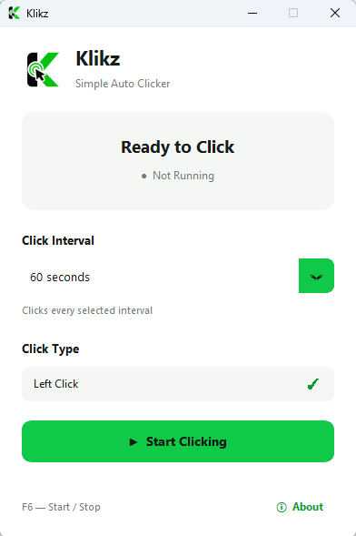
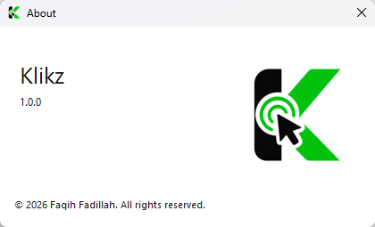

Link : https://github.com/faqihfadillah2215/Klikz-Auto-Clicker/releases/download/v1.0.0/Klikz.exe

# Klikz

**A lightweight auto-clicker desktop application for Windows, built with Python.**  
**Aplikasi auto-clicker desktop yang ringan untuk Windows, dibuat dengan Python.**

**Languages / Bahasa:** [English](#english) · [Bahasa Indonesia](#bahasa-indonesia)

---

## English

### Overview

Klikz is a simple Windows desktop auto-clicker with a clean light-mode interface, configurable click intervals, an F6 keyboard shortcut, and system tray integration. It performs **left mouse clicks at the current cursor position** while enabled.

> **Important:** Klikz generates mouse clicks. It does **not** guarantee that Windows will remain awake or prevent automatic locking. Do not use it to circumvent your organization's security policies or on production systems without approval.

### Features

- Minimal light-mode GUI with a green-and-black Klikz icon
- Start/Stop button and running status indicator
- Adjustable intervals: **10, 30, or 60 seconds; 2 or 5 minutes** (default: 60 seconds)
- **Left-click automation** at the cursor's current position
- **F6** global hotkey to start or stop clicking
- Minimize or close the window to the **system tray**; clicking can continue while minimized
- Tray menu: **Open Klikz**, **Start/Stop Clicking**, **Exit**
- **About** window with app version and developer credit
- PyAutoGUI corner fail-safe and application log file
- Build as a standalone Windows `.exe` with PyInstaller

**Note:** The first click happens **after** the selected interval, not immediately when you press Start. Changing the interval restarts the waiting period.

### Requirements

- Windows 11 (target platform)
- Python 3.14 and `pip` for running from source
- Git (optional, for version control)

Python dependencies are listed in [`requirements.txt`](requirements.txt): CustomTkinter, PyAutoGUI, pynput, pystray, Pillow, and PyInstaller.

### Installation and run

Open PowerShell in the project root and run:

```powershell
py -m venv .venv
.\.venv\Scripts\python.exe -m pip install --no-cache-dir -r requirements.txt
.\.venv\Scripts\python.exe .\src\main.py
```

Using `.venv\Scripts\python.exe` directly avoids changing PowerShell's execution policy.

### How to use

1. Launch Klikz.
2. Select a click interval (default: **60 seconds**).
3. Click **Start Clicking** or press **F6**.
4. After each interval, Klikz performs a left click wherever the mouse cursor is located.
5. Click **Stop Clicking** or press **F6** again to stop.
6. Minimize to the tray to keep the application running, or use **System Tray → Exit** to close it completely. **Ctrl+Q** exits when the main window has focus.

**Safety:** Test with an empty document or another noncritical application. Do not leave automatic clicking active over monitoring dashboards, forms, or sensitive controls. Moving the cursor into a screen corner triggers PyAutoGUI's fail-safe when the next automated click is attempted; use **F6** for an immediate stop request.

### Build a Windows executable

Run from the project root on Windows:

```powershell
.\.venv\Scripts\python.exe -m PyInstaller --noconfirm --clean --onefile --windowed --name Klikz --icon "assets\klikz.ico" --add-data "assets;assets" --collect-all customtkinter "src\main.py"
```

The resulting file is `dist\Klikz.exe`. A Windows build should be created on Windows. The executable does not require a separate Python installation on the destination machine; Windows security tools may still inspect unsigned executables.

### Project structure

```text
Klikz/
├── assets/
│   ├── klikz.png
│   └── klikz.ico
├── src/
│   └── main.py
├── requirements.txt
├── README.md
├── .gitignore
└── LICENSE
```

Generated folders such as `.venv/`, `build/`, and `dist/` are excluded from Git. You can publish an executable separately through GitHub Releases after testing.

### Troubleshooting

- **PowerShell blocks `Activate.ps1`:** Activation is optional. Run Python directly from `.venv\Scripts\python.exe` as shown above.
- **`pip` reports a cache permission error:** Retry dependency installation with `--no-cache-dir`.
- **Tray icon is not visible:** Check Windows' hidden system tray icons.
- **Unexpected behavior:** Review `%LOCALAPPDATA%\Klikz\klikz.log` and stop automation before investigating.

### Developer & license

Developed by **Faqih Fadillah**.  
Licensed under the [MIT License](LICENSE). Copyright © 2026 Faqih Fadillah.

---

## Bahasa Indonesia

### Tentang Klikz

Klikz adalah aplikasi auto-clicker desktop sederhana untuk Windows dengan antarmuka light mode, pilihan interval klik, shortcut keyboard F6, dan integrasi System Tray. Saat aktif, Klikz melakukan **klik kiri pada posisi cursor saat itu**.

> **Penting:** Klikz menghasilkan input klik mouse otomatis. Aplikasi ini **tidak menjamin** layar Windows akan tetap menyala atau mencegah penguncian otomatis. Jangan gunakan aplikasi untuk menghindari kebijakan keamanan perusahaan atau pada sistem production tanpa persetujuan.

### Fitur

- GUI minimalis dengan light mode dan logo Klikz hijau-hitam
- Tombol Start/Stop dan indikator status
- Pilihan interval: **10, 30, atau 60 detik; 2 atau 5 menit** (default: 60 detik)
- **Klik kiri otomatis** di posisi cursor saat klik dijalankan
- Hotkey global **F6** untuk menjalankan atau menghentikan auto click
- Minimize atau tutup jendela ke **System Tray**; auto click dapat tetap berjalan
- Menu tray: **Open Klikz**, **Start/Stop Clicking**, **Exit**
- Jendela **About** berisi versi dan informasi developer
- PyAutoGUI fail-safe di sudut layar dan file log aplikasi
- Dapat di-build menjadi file `.exe` menggunakan PyInstaller

**Catatan:** Klik pertama dilakukan **setelah interval yang dipilih**, bukan langsung saat tombol Start ditekan. Mengubah interval akan mengulang waktu tunggu.

### Kebutuhan sistem

- Windows 11 (platform tujuan)
- Python 3.14 dan `pip` untuk menjalankan source code
- Git (opsional, untuk version control)

Dependency tersedia di [`requirements.txt`](requirements.txt): CustomTkinter, PyAutoGUI, pynput, pystray, Pillow, dan PyInstaller.

### Instalasi dan menjalankan aplikasi

Buka PowerShell pada folder utama project, lalu jalankan:

```powershell
py -m venv .venv
.\.venv\Scripts\python.exe -m pip install --no-cache-dir -r requirements.txt
.\.venv\Scripts\python.exe .\src\main.py
```

Pemanggilan Python langsung dari `.venv\Scripts\python.exe` tidak memerlukan perubahan Execution Policy PowerShell.

### Cara penggunaan

1. Buka aplikasi Klikz.
2. Pilih interval klik (default: **60 detik**).
3. Klik **Start Clicking** atau tekan **F6**.
4. Klikz melakukan klik kiri secara berkala di lokasi cursor ketika interval selesai.
5. Klik **Stop Clicking** atau tekan **F6** lagi untuk menghentikan.
6. Minimize ke System Tray jika ingin aplikasi tetap berjalan, atau pilih **System Tray → Exit** untuk menutup sepenuhnya. **Ctrl+Q** dapat digunakan untuk keluar saat jendela utama sedang aktif.

**Keamanan:** Uji dahulu di dokumen kosong atau aplikasi nonkritis. Jangan biarkan auto click aktif di atas dashboard monitoring, formulir, atau kontrol sensitif. Memindahkan cursor ke sudut layar mengaktifkan PyAutoGUI fail-safe saat percobaan klik otomatis berikutnya; gunakan **F6** jika perlu menghentikan dengan cepat.

### Build aplikasi Windows (`.exe`)

Jalankan perintah berikut dari folder utama project pada Windows:

```powershell
.\.venv\Scripts\python.exe -m PyInstaller --noconfirm --clean --onefile --windowed --name Klikz --icon "assets\klikz.ico" --add-data "assets;assets" --collect-all customtkinter "src\main.py"
```

Hasilnya ada di `dist\Klikz.exe`. Build Windows dilakukan di Windows. File EXE tidak memerlukan instalasi Python terpisah di komputer tujuan, tetapi aplikasi tanpa digital signature masih dapat diperiksa oleh software keamanan.

### Struktur project

```text
Klikz/
├── assets/
│   ├── klikz.png
│   └── klikz.ico
├── src/
│   └── main.py
├── requirements.txt
├── README.md
├── .gitignore
└── LICENSE
```

Folder hasil generate seperti `.venv/`, `build/`, dan `dist/` tidak dimasukkan ke Git. Jika sudah diuji, file EXE bisa dipublikasikan secara terpisah melalui GitHub Releases.

### Troubleshooting

- **PowerShell menolak `Activate.ps1`:** Aktivasi Virtual Environment tidak wajib. Jalankan Python langsung dari `.venv\Scripts\python.exe`.
- **`pip` gagal karena permission cache:** Ulangi instalasi dependency menggunakan `--no-cache-dir`.
- **Icon tray tidak terlihat:** Periksa area hidden system tray icons di Windows.
- **Aplikasi mengalami error:** Periksa `%LOCALAPPDATA%\Klikz\klikz.log` dan hentikan auto click sebelum melakukan troubleshooting.

### Developer dan lisensi

Dikembangkan oleh **Faqih Fadillah**.  
Menggunakan [MIT License](LICENSE). Copyright © 2026 Faqih Fadillah.

## Screenshots / Tampilan Aplikasi

### Main Window / Tampilan Utama


### About Window / Tentang Aplikasi

